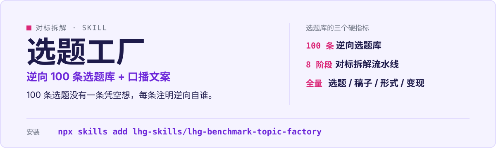

<p align="center">
  
</p>

# lhg-benchmark-topic-factory · 对标拆解选题工厂

把任意行业 / 赛道的头部博主深挖到底，逆向产出 100 条选题库 + 完整口播文案库 + 排期规划。

（SKILL.md v1.1.0）

## 它是什么

- 8 阶段流水线：找对标 → 拆选题、稿子、展现形式、变现全量数据 → 逆向出选题。
- 100 条选题没有一条是凭空想的，每条都注明逆向自谁的爆款公式。
- 产出选题库 + 口播文案库 + 排期规划三件套。
- references 含 agent-prompts 与 data-sources 两个实操文档。

## 先试一句

| 你说 | 它给你 |
|---|---|
| 我想做 X 赛道的自媒体，帮我调研对标并产出内容 | 8 阶段流水线：深挖头部博主，逆向 100 条选题 + 口播文案 + 排期 |
| 找对标，挖选题 | 选题 / 稿子 / 展现形式 / 变现全量拆解 |
| 做选题库，100 条 | 每条选题注明来源公式，不凭空编 |

## 安装

```bash
npx skills add lhg-skills/lhg-benchmark-topic-factory
```

<details>
<summary>发给 Agent 的安装话术（推荐：小白用户直接复制整段发给你的 Agent）</summary>

> 请帮我安装 Skill「lhg-benchmark-topic-factory」：先从 Gitee 上 lhg-skills 组织下的 lhg-benchmark-topic-factory 仓库下载；如果 Gitee 无法访问或下载失败，改从 GitHub 上 lhg-skills 组织下的同名仓库下载。按当前 Agent 的规范安装其中的 Skill，优先全局安装，保留完整目录和依赖。请直接执行，完成后验证是否安装成功，告诉我实际使用的来源、安装的版本号以及如何调用；遇到访问或安装限制请说明具体原因。需要输入管理员密码或确认风险时停下来等我。

**怎么算装好了**：Agent 能在已安装的 Skill 里看到 `lhg-benchmark-topic-factory`，并报出版本号（与仓库 `SKILL.md` 的 `version` 一致）。只是打开了仓库网页不算安装。

</details>


## 它怎么做

1. 确认赛道与对标范围
2. 深挖头部博主（选题 / 稿子 / 形式 / 变现）
3. 逆向爆款公式
4. 产出 100 条选题库
5. 完整口播文案库
6. 排期规划

触发条件（写在 SKILL.md 里）：只要同时出现「调研博主 / 账号」和「要选题 / 文案 / 内容规划」，即使没提「对标」两个字也该用。

## 什么时候用 / 不用

**用它，当你：**

- 起号 / 做号前找对标、挖选题
- 要 100 条带来源的选题库，不止灵感
- 要口播文案 + 排期一次给齐

**别用它，当你：**

- 只要几条灵感——它按 100 条选题库交付
- 不给对标范围——先确认赛道再开工
- 选题不注明来源——每条都必须能追溯到爆款公式

## 目录结构

```
SKILL.md            skill 全文
references/
  agent-prompts.md  对标拆解实操提示词
  data-sources.md   数据来源说明
  smoke-test.md     自检用例
  fixtures/         4 个对照用例
scripts/
  smoke_test.py     冒烟脚本
LICENSE             MIT
manifest.yaml
icon-512.png
```

## 自检与反馈

冒烟：`python3 scripts/smoke_test.py references/fixtures/fixture-banned.md --banned-words 绝绝子 --no-isolation`（另有默认禁词、隔离词 2 个用例，见 [references/smoke-test.md](references/smoke-test.md)；全部用例 2026-09-29 实测通过）。

发现问题请提 issue：[提一个 issue](https://github.com/lhg-skills/lhg-benchmark-topic-factory/issues/new)（标题以 `[QC] ` 开头，写清你让它做了什么、它实际给了什么）。

---

## 出品：刘洪光

本 skill 由真人出镜 IP「刘洪光」（安徽合肥）出品，归属 [lhg-skills](https://github.com/lhg-skills)。

- GitHub 主页：https://github.com/lhg-skills —— 全部 skill 开源在此，欢迎 star
- 抖音：搜「刘老师讲AI实战」
- 微信：lhgsmsw

觉得有用，欢迎点 ⭐ Star。
